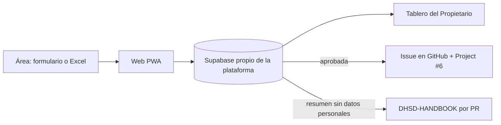

# DHSD Plataforma

Plataforma central de DH SOFTWARE DATA para recibir **solicitudes de módulos** y **reportes en Excel** de cada área, y ver el estado de todo en un tablero.

> Estado: **prototipo en modo demostración**. La web funciona sin servidor con datos de ejemplo. El esquema de base de datos está probado en PostgreSQL 16 y espera su proyecto de Supabase. No hay datos reales ni producción.

## Cómo encaja con el resto



- Las áreas **solo envían** solicitudes y archivos; nunca tocan las bases de datos de la empresa ni el sistema integral.
- El Propietario decide: aprueba, rechaza, prioriza. Cada cambio queda en una bitácora.
- GitHub guarda código, decisiones y documentación. Supabase guarda las solicitudes y los archivos.
- El proyecto de Supabase de esta plataforma es **propio**; no se usa el de DH Rutas ni ningún proyecto en producción.

## Qué hay

| Carpeta | Contenido |
|---|---|
| `web/` | App web instalable (PWA), sin dependencias de compilación |
| `supabase/migrations/` | Esquema, roles y seguridad por filas |
| `supabase/tests/` | Pruebas de seguridad que corren en cada cambio |
| `tests/` | Pruebas de la lógica de la web |
| `docs/` | Arquitectura, conexión a Supabase y pendientes del Propietario |

## Ver la web ahora (modo demostración)

```bash
npm run serve      # abre http://localhost:8080
```

Sin instalar nada más. Con `web/config.js` vacío funciona en demostración.

## Pruebas

```bash
npm test                                   # lógica de la web
# Base de datos (PostgreSQL 16):
psql -f supabase/tests/00_stub_supabase.sql && psql -f supabase/migrations/0001_base.sql && psql -f supabase/tests/rls_test.sql
```

## Siguiente paso

Ver [docs/PENDIENTES_PROPIETARIO.md](docs/PENDIENTES_PROPIETARIO.md) y [docs/CONEXION_SUPABASE.md](docs/CONEXION_SUPABASE.md).
