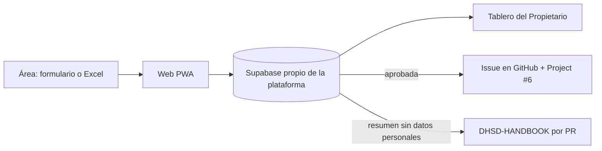

# DHSD Plataforma

Plataforma central de DH SOFTWARE DATA para recibir **solicitudes de módulos** y **reportes en Excel** de cada área, y ver el estado de todo en un tablero.

> Estado: **prototipo conectado a su propio proyecto de Supabase (`dhsd-plataforma`), sin datos reales**. El esquema está aplicado y probado; falta crear el usuario del Propietario y cargar las áreas. Para ver la web en modo demostración, deja vacíos `SUPABASE_URL` y `SUPABASE_ANON_KEY` en `web/config.js`.

## Cómo encaja con el resto



- Las áreas **solo envían** solicitudes y archivos; nunca tocan las bases de datos de la empresa ni el sistema integral.
- El Propietario decide: aprueba, rechaza, prioriza. Cada cambio queda en una bitácora.
- GitHub guarda código, decisiones y documentación. Supabase guarda las solicitudes y los archivos.
- El proyecto de Supabase de esta plataforma es **propio**; no se usa el de DH Rutas ni ningún proyecto en producción.

## Qué hay

| Carpeta | Contenido |
|---|---|
| `web/` | App web instalable (PWA), sin dependencias de compilación |
| `supabase/migrations/` | Esquema, roles y seguridad por filas |
| `supabase/tests/` | Pruebas de seguridad que corren en cada cambio |
| `tests/` | Pruebas de la lógica de la web |
| `docs/` | Arquitectura, conexión a Supabase y pendientes del Propietario |

## Ver la web ahora (modo demostración)

```bash
npm run serve      # abre http://localhost:8080
```

Con la configuración actual pedirá ingreso con un usuario de Supabase. Para la demostración con datos de ejemplo, deja vacíos los dos valores de `web/config.js`.

## Pruebas

```bash
npm test                                   # lógica de la web
# Base de datos (PostgreSQL 16):
psql -f supabase/tests/00_stub_supabase.sql && for f in supabase/migrations/*.sql; do psql -f $f; done && psql -f supabase/tests/rls_test.sql
node tests/secretos.mjs                    # busca secretos
```

## Siguiente paso

Ver [docs/PENDIENTES_PROPIETARIO.md](docs/PENDIENTES_PROPIETARIO.md) y [docs/CONEXION_SUPABASE.md](docs/CONEXION_SUPABASE.md).
